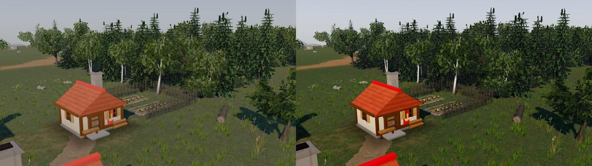
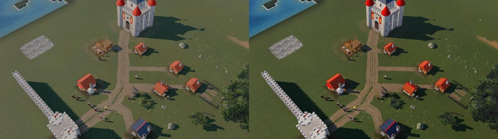

# Phase 5A – Teilschritt 5: Referenzumgebung (Terrain, Vegetation, Licht)

Stil `medieval` (`?lookdev=medieval`, `?style=medieval`). Der Stil `classic` ist unverändert (Nachweis unten).
Alle Zeiten/Bildraten: Chromium mit **Software-GL (SwiftShader)**, 4 Kerne, Rechner parallel stark belastet – **keine
GPU-Werte**. Safari/MacBook Air M3 ist nicht gemessen.

<!-- STAND -->

## 1. Überblick

| Bereich | Umsetzung | Code / Quelle |
| --- | --- | --- |
| Vegetation | 24 GLB-Assets aus Blender-Skripten: Stieleiche, Hängebirke, Fichte je 3 Varianten (davon 1 Jungbaum), Hasel/Weißdorn, 2 Gräser, 2 Blumenmischungen, Farn, Findling/Fels/Platte/Lesesteine, Holzzaun, Flechtzaun, Gemüsebeet, liegender Stamm | `assets/blender/models/veg_*.py`, Bibliothek `assets/blender/lib/sp/veg.py` |
| Vegetation (Laufzeit) | Instancing je (Asset × LOD × Material), LOD je Instanz nach Abstand, Sichtkegel-Auslese, Verteilung rein/deterministisch, Wind, Alpha-Test inkl. Schattenpass, Durchlicht, Rückfall auf die prozedurale Dekoration | `render/env/veg_layer.ts`, `veg_place.ts`, `veg_material.ts` |
| Gelände | eigenes PBR-Material: Bibliothekstexturen Gras/Erde/Weg/Fels als Textur-Arrays, höhenbasierte Übergänge (ORM.a), Makro-Variation, zweite gedrehte Abtastung (Hoch), Klippen seitlich projiziert, Kriegsnebel/Chunks/Bodenkarte wie bisher | `render/env/terrain_medieval.ts`, `render/terrain.ts` (Zweig `medieval`) |
| Wege | Umgebungskarte (Wegstärke, Querabstand mit Vorzeichen, Richtung, Kronendach, Fahrspuren): Wegtextur entlang des Weges ausgerichtet (Spurrillen laufen mit), ausgefranste Ränder, Grasstreifen in der Mitte von Karrenwegen, Trampelpfade enden am nächsten Weg | `render/env/envmap.ts`, `groundmap.ts trailSegments` |
| Licht | Sonne aus dem Sonnenstand (Farbe 3.400–5.800 K-Anmutung), prozeduraler Himmel → PMREM (Himmelslicht + Glanz) und Hintergrund, Halbkugel nur für Rückfallmodelle, Schattenkamera auf den sichtbaren Boden eingepasst | `render/env/atmosphere.ts`, `render/scene.ts` |
| Atmosphäre | Exponentialnebel in Horizontfarbe (durch denselben Tonemapper geschickt), Höhendunst, Obergrenze für Lesbarkeit | `atmosphere.ts` (FOG_EXP2-Zweig der three-Chunks) |
| Tonemapping | AgX + Abstimmung (Sättigung 1,12, Kontrast 1,06, leichte Teiltonung); ACES zum Vergleich (`&tone=aces`) | `atmosphere.ts CustomToneMapping` |

## 2. Vegetation

### 2.1 Assets (Blender-Skripte, reproduzierbar; Dreiecke LOD0/LOD1/LOD2, Karten zählen)

| Asset | Beschreibung | Klasse / Rolle | Dreiecke LOD0/1/2 | Budget | Materialien | GLB |
| --- | --- | --- | --- | --- | --- | --- |
| `veg_birch_a` | Haengebirke, einstaemmig | tree / mature | 4680 / 658 / 121 | 6000 / 1500 / 300 | M_Bark, M_Foliage | 292 KB |
| `veg_birch_b` | Haengebirke, kleiner, schief | tree / young | 3659 / 565 / 103 | 6000 / 1500 / 300 | M_Bark, M_Foliage | 230 KB |
| `veg_birch_c` | Haengebirke, zweistaemmig | tree / mature | 5960 / 918 / 184 | 6000 / 1500 / 300 | M_Bark, M_Foliage | 374 KB |
| `veg_bush_a` | Haselstrauch: viele Triebe aus dem Boden, lockere Krone | bush / bush | 1924 / 246 / 32 | 2400 / 700 / 160 | M_Bark, M_Foliage | 126 KB |
| `veg_bush_b` | Weissdorn: dicht, rundlich | bush / bush | 1718 / 163 / 18 | 2400 / 700 / 160 | M_Bark, M_Foliage | 112 KB |
| `veg_fence_rail` | Holzzaun: Eichenpfosten mit zwei Spaltstangen (1 Einheit) | prop / fence | 130 / 73 / 32 | 1500 / 600 / 150 | M_Timber_Oak | 18 KB |
| `veg_fence_wattle` | Flechtzaun: Staken mit geflochtenen Haselruten (1 Einheit) | prop / fence | 939 / 240 / 43 | 1500 / 600 / 150 | M_Bark | 82 KB |
| `veg_fern_a` | Farn (Wurmfarn), sieben Wedel | flora / fern | 392 / 132 / 12 | 420 / 140 / 40 | M_Flora | 48 KB |
| `veg_flowers_a` | Wiesenblumen | flora / flowers | 106 / 39 / 20 | 420 / 140 / 40 | M_Flora | 15 KB |
| `veg_flowers_b` | Wiesenblumen | flora / flowers | 111 / 43 / 20 | 420 / 140 / 40 | M_Flora | 15 KB |
| `veg_garden_bed` | Gemuesebeet: Erdhuegel mit Brettern, Kohl und Lauch | prop / garden | 472 / 144 / 48 | 1500 / 600 / 150 | M_Flora, M_Ground_Dirt, M_Wood_Planks | 56 KB |
| `veg_grass_a` | Grasbueschel | flora / grass | 110 / 12 / 5 | 420 / 140 / 40 | M_Flora | 16 KB |
| `veg_grass_b` | Grasbueschel (hoch, Samenstaende) | flora / grassTall | 106 / 18 / 4 | 420 / 140 / 40 | M_Flora | 16 KB |
| `veg_log` | liegender Baumstamm mit Rinde und Schnittflaechen | prop / log | 210 / 100 / 30 | 1500 / 600 / 150 | M_Bark, M_Timber_Oak | 28 KB |
| `veg_oak_a` | Stieleiche, ausgewachsen, breite Krone | tree / mature | 4724 / 518 / 151 | 6000 / 1500 / 300 | M_Bark, M_Foliage | 311 KB |
| `veg_oak_b` | Stieleiche, hoeher, unregelmaessige Krone, leicht schief | tree / mature | 3761 / 450 / 129 | 6000 / 1500 / 300 | M_Bark, M_Foliage | 250 KB |
| `veg_oak_c` | junge Eiche | tree / young | 2277 / 312 / 73 | 6000 / 1500 / 300 | M_Bark, M_Foliage | 148 KB |
| `veg_rock_a` | Findling: gerundet, halb eingesunken, moosig | rock / boulder | 1280 / 320 / 80 | 1500 / 500 / 150 | M_Rock | 111 KB |
| `veg_rock_b` | kantiger Fels mit Bruchflaechen und Schichtung | rock / rock | 1280 / 320 / 80 | 1500 / 500 / 150 | M_Rock | 107 KB |
| `veg_rock_c` | flache Felsplatte, rissig, moosig | rock / rock | 1280 / 320 / 80 | 1500 / 500 / 150 | M_Rock | 104 KB |
| `veg_rock_d` | Lesesteine (vier Steine) | rock / stones | 1280 / 320 / 80 | 1500 / 500 / 150 | M_Rock | 119 KB |
| `veg_spruce_a` | Fichte, ausgewachsen | tree / mature | 5683 / 586 / 150 | 6000 / 1500 / 300 | M_Bark, M_Foliage_Conifer | 380 KB |
| `veg_spruce_b` | Fichte, mittel, dicht | tree / mature | 5544 / 560 / 150 | 6000 / 1500 / 300 | M_Bark, M_Foliage_Conifer | 370 KB |
| `veg_spruce_c` | junge Fichte | tree / young | 3191 / 354 / 114 | 6000 / 1500 / 300 | M_Bark, M_Foliage_Conifer | 214 KB |

Summe GLB 3.5 MB (unkomprimiert; gzip ≈ 65 %). Bearbeitbare Quellen: Skripte + `assets/src/veg/*.blend`.

Aufbau der Bäume (`veg_trees.py`): deterministisches Skelett je Variante – Stamm mit Wurzelanlauf (Rippen am Fuß),
Starkäste wachsen zu Zielpunkten auf einer Kronenhülle (Ellipsoid), Seitenäste bis zur Hülle; Blattkarten (Atlas `M_Foliage`,
Zellen Eiche/Birke; bei der Birke hängend) an den äußeren Zweigabschnitten, Kartennormalen von der Kronenmitte nach außen,
AO analytisch (innen/unten dunkler). Fichte: Quirle waagrechter Äste mit aufgebogenen Spitzen, Nadelzweig-Karten
(`M_Foliage_Conifer`, eigene prozedurale Textur) liegend und hängend, Wipfel aus gekreuzten Karten. LOD1: gleiches Skelett,
nur Stamm/Starkäste, Karten im Raster 0,2 gebündelt (größer); LOD2: Stamm + Hüllkarten (impostorartig, ≤ 300 Dreiecke).
Gras/Blumen/Farn sind Geometrie (Halme, Blütenfächer, Fiederblättchen) mit Palette `M_Flora` – kein Alpha-Test, also kein
Overdraw-Problem bei dichtem Gras. Felsen: verformte Ikosaeder (Rauschen, Bruchflächen durch Ebenenschnitte, Schichtung),
LOD aus derselben Form mit weniger Unterteilung, Moosanteil in der Datenfarbe, AO per Cycles-Bake.

### 2.2 Laufzeit (`render/env/`)
- **Katalog** aus dem Manifest (`veg.kind/species/role`), nichts ist im Code fest verdrahtet; fehlt eine Baumart oder
  scheitert das Laden, bleibt die prozedurale Dekoration (Rückfall, `console.info`). Bis die Assets geladen sind, zeichnet
  ebenfalls die prozedurale Dekoration.
- **Verteilung** (`veg_place.ts`, rein): jeder Baum-Tile bekommt einen Baum (Holz-Ressource bleibt sichtbar), Art aus Biom
  und Terrain → Eiche/Birke/Fichte, Variante per Hash; dichter Wald: Jungwuchs, Büsche, Farn; Waldsaum: Büsche, Farn, hohes
  Gras; Wiese: Grasbüschel (Dichte nach Stufe und Feuchte, nicht auf Wegen/Feldern/Gebäuden), Blumen in Rauschflecken,
  vereinzelt Büsche, Lesesteine, Findlinge; Felsgelände/Vorkommen: Felsen (getönt nach Vorkommen).
- **LOD** je Instanz nach Kameraabstand: Bäume 21/50, Büsche 14/34, Flora 9/20 (danach keine), Felsen 18/44, Requisiten
  16/40 Einheiten × Stufenfaktor (Niedrig 0,7, Mittel 1, Hoch 1,45); Niedrig nie Baum-LOD0. Fernformen (LOD2) der
  ausgewachsenen Varianten einer Art teilen sich ein Mesh und werfen keine Schatten (weniger Draw-Calls).
- **Auslese**: Instanzen außerhalb des um 5 Einheiten erweiterten Sichtkegels entfallen (Schatten knapp außerhalb stehender
  Bäume bleiben); Kameradrehung verteilt neu.
- **Instancing** je (Asset × LOD × Material) ein `InstancedMesh`; Draw-Calls unabhängig von der Instanzzahl.
- **Material** (`veg_material.ts`): ein MeshStandardMaterial je Bibliotheksname; Wind wie das bestehende Schwanken
  (gleiche Uniforms `uTime/uWind/uWindDir/uTreeSway`, Biegung ∝ Biegsamkeit², Äste phasenversetzt, Blätter/Halme flattern),
  Schattenmaterial mit derselben Bewegung **und Alpha-Test** (schließt die Lücke „Laub-Alpha im Schattenpass“), Alpha-Erhalt in
  den Mipmaps, Alpha-to-Coverage mit Kantenglättung, Rückseiten-Normalen nicht umgedreht (weiche Krone), Durchlicht (Sonne von
  hinten, verschattet), Laub matt (kein bläulicher Himmelsglanz), Birkenrinde und Moos aus der Datenfarbe; Kachelgröße der
  Rinde/des Felsens wird zur Laufzeit an die Bibliothek angepasst (`uvTile`).
- **Gras am Sichtrand** schrumpft weich aus (kein harter Rand beim Nachverteilen).

## 3. Gelände und Wege
- Gleiche Architektur wie classic (Chunks à 32 Tiles, Terrassen, Klippen, Wasser, Kriegsnebel über die Vertexfarbe,
  Bodenkarte), im Stil medieval aber eigener Materialpfad: Vertexfarbe = Tönung (≈ 1) der Texturen, zusätzliches Attribut
  `aMed` (Kartenrand, Feuchte); Wasser natürlicher getönt.
- Material: Gras/Erde/Weg/Fels aus der Materialbibliothek als **Textur-Arrays** (je Karte ein Sampler, Safari hat 16
  Textureinheiten), Weltmaß-UVs mit der Kachelgröße der Bibliothek; Gewichte aus Terrain, Rauschflecken (trockene Stellen),
  Bodenkarte (getretene Erde, Felder mit Furchen), Umgebungskarte (Wege, Laubstreu unter Bäumen); **höhenbasierte
  Übergänge** über die Höhe in ORM.a, falls vorhanden – die ausgelieferten WebP-ORM tragen keine Höhe (Alpha = 1), daher
  Ersatzhöhe aus AO (Hohlräume tief) + Helligkeit; Makro-Variation (zwei Rauschebenen, trockene/satte Flecken);
  Hoch: zweite gedrehte/skalierte Abtastung gegen Kachelwiederholung; Normalen der Texturen ab Mittel, Niedrig nur Albedo+ORM.
- Wege: Wegtextur entlang der Wegrichtung (die Spurrillen der Bibliothekstextur folgen dem Weg; an Kreuzungen Weltprojektion,
  damit nichts verschmiert), Kontrast der Rillen gemildert (dunkle Rillen der Textur auf ≥ 72 % der Grundfarbe angehoben), Ränder mit drei Rauschfrequenzen ausgefranst, Grasstreifen in der
  Mitte von Karrenwegen. Fehlen Texturen, zeichnet ein prozeduraler Rückfall aus den Grundfarben der Bibliothek.
- Texturspeicher: 3 Arrays × 4 Schichten; Mittel/Hoch 1024² (≈ 67 MB unkomprimiert inkl. Mipmaps), Niedrig 512² (≈ 17 MB).

## 4. Licht, Schatten, Atmosphäre
- Sonne Standard Stil medieval: Azimut 232° (Südwest), Höhe 34° (Nachmittag; Spiel und LookDev gleich, LookDev-Regler
  bleibt), Farbe aus der Höhe, Stärke 3,5 (flach etwas schwächer). Himmel prozedural (Zenit, dunstiger Horizont,
  Aureole, Bodenreflex) als 128×64-Equirect → PMREM (`scene.environment`, Stärke 0,85) und Hintergrund; die
  Halbkugel-Lichtquelle trägt dieselben Himmelsfarben, wirkt aber nur auf Lambert-Rückfallmodelle (`uHemiK`).
- Schatten: Schattenkamera auf die Bodenpunkte der Sichtpyramide eingepasst (Rechteck je Achse, Fernpunkte auf 2,2 ×
  Kameraabstand begrenzt) – bei RTS-Sicht deutlich mehr Texel je Einheit als der feste Radius; Texel-Snapping je Achse;
  Normal-Bias = 1,1 Texel, Tiefen-Bias −0,00012 (weder Akne auf Blattkarten noch Peter-Panning an Hauswänden in den
  Nahaufnahmen); volle Schattenstärke (Aufhellung kommt aus dem Himmelslicht). Kontaktschatten: gebackene AO der Assets
  (mit Bodenplatte), Bodenkarte an Gebäuden, Kronendach-AO im Gelände.
- Nebel: FOG_EXP2 (nur Stil medieval), Hälfte bei 3,2 × Kameraabstand, über 1–7 Einheiten Höhe auf 62 % ausgedünnt,
  höchstens 85 %; Farbe = Horizont des Himmels durch denselben Tonemapper gerechnet (three mischt den Nebel nach dem
  Tonemapping) → nahtloser Übergang zum Hintergrund.
- Tonemapping AgX + Abstimmung; das globale Grading aus `materials.ts` wird im Stil medieval übersprungen (`spGradeMode`),
  classic unverändert. **Kein Bloom** (zusätzliche Render-Ziele/Programme, auf Safari/M3 nicht gemessen – bewusst weggelassen).

### Tonemapping-Vergleich AgX ↔ ACES (Mittel, gleiche Szene/Sonne, links AgX, rechts ACES)

Entscheidung **AgX**: ACES verdunkelt die Schatten deutlich (Figuren im Hausschatten schlechter lesbar), sättigt Ziegelrot
und Grün stark (Richtung Postkarte) und verschiebt helle Töne ins Gelbliche. AgX rollt Lichter weicher ab und hält
Stein/Putz/Holz neutral; die fehlende Spannung gleicht die Abstimmung aus (Sättigung 1,12, Kontrast 1,06). ACES bleibt
für Vergleiche abrufbar (`&tone=aces`).

## 5. LookDev
- Szene ergänzt (`lookdev_scene.ts`): Karrenweg vom Tor über den Platz, Abzweig zum Bergfried, Gasse zur Schmiede,
  Fußpfad zur Bäckerei (`road`), einzelne Solitärbäume (`tree`), Gärten mit Flechtzaun, Weide mit Holzzaun, Findling,
  Lesesteine, liegender Stamm (`prop`, `propLine`); Waldsäume wie bisher.
- Neue Kamera `3h-landscape` (Landschafts-Nahkamera: Garten, Waldsaum Eiche/Birke/Fichte, Wiese).
- `&tone=agx|aces` (Vergleich), LookDev wartet auf Bodentexturen und Vegetation (`GameScene.whenEnvReady`), ebenso `?bench&style=medieval`.

<!-- MESSUNG -->

